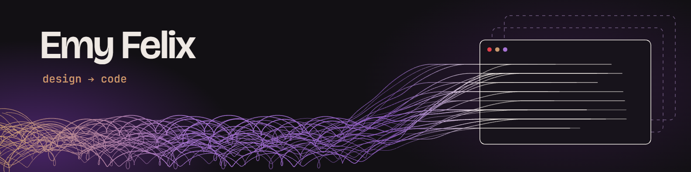
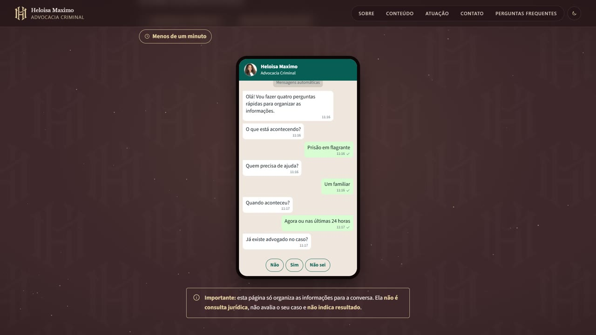

## Featured project: Heloisa Maximo

A website for a criminal lawyer that had to feel serious, explain her work simply and make the first contact easier.

<table>
  <tr>
    <td width="50%"></td>
    <td width="50%">
      <ul>
        <li>3D statue with a camera driven by scroll</li>
        <li>Guided chat that organizes each case before WhatsApp</li>
        <li>Admin panel to edit the site's content</li>
        <li>Light and dark themes</li>
      </ul>
    </td>
  </tr>
</table>

**My role:** design, front-end, content panel and deploy. 
**Stack:** React, Three.js, React Three Fiber, Supabase, Vercel.

[Live site](https://advheloisamaximo.vercel.app) · [Code](https://github.com/msoueu/site-heloisa-maximo)

## What I can build for you

| Business websites | Interactive 3D pages | Editable content |
| --- | --- | --- |
| Clear pages designed for your work and your clients | Motion and 3D that give a brand its own presence | A simple panel so you can update text without code |

## Tech stack

